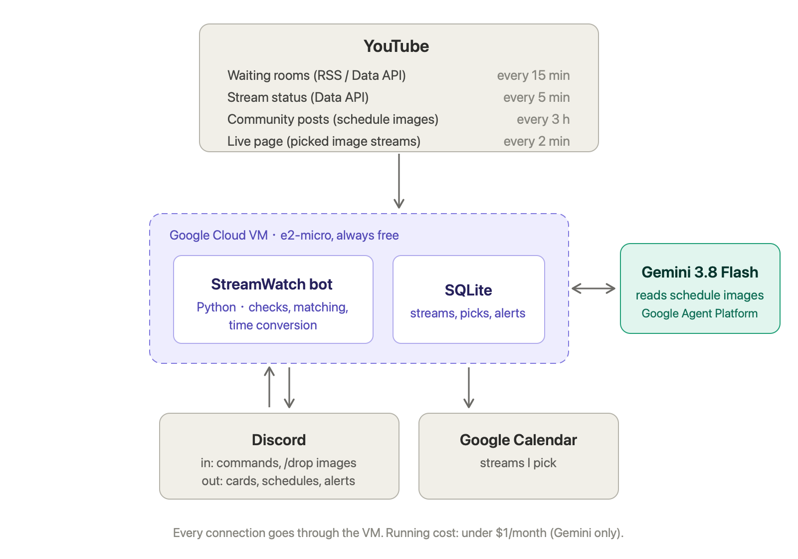

# StreamWatch

An AI agent that keeps track of the YouTube streamers I follow, so I don't have to.

It finds upcoming streams from YouTube waiting rooms and community posts, reads schedule images with Gemini, shows everything in a private Discord server in my own timezone, adds the streams I pick to Google Calendar, and pings me when they go live.

## Why

I follow many YouTube streamers. Finding something to watch meant clicking through channel after channel to see who was live, and schedules are posted as images, at random times, in other timezones. I spent more time checking than watching, and still missed streams.

## What it does

- **Watches every channel:** new waiting rooms show up in Discord within 15 minutes.
- **Reads schedule images:** Gemini extracts each stream from the image, code converts the times to my timezone, and anything that fails a cross-check is flagged for human review.
- **Builds my week:** a weekly digest every Sunday, and `/digest` for the next 7 days at any time.
- **Alerts only for what matters:** one tap adds a stream to Google Calendar. I get pinged when my picks go live, or when a streamer goes live with no notice (or less than an hour's notice).
- **Keeps cards current:** cards turn purple when a stream is on my calendar and red when it goes live; reschedules and cancellations update the calendar.

## Architecture

Everything runs on one always-free Google Cloud VM; Gemini is only called to read schedule images.

| Part | Role |
|---|---|
| Python bot ([discord.py](https://github.com/Rapptz/discord.py)) | Timed checks, matching and time conversion; slash commands, cards and alerts |
| SQLite | Streamers, streams, picks, alerts already sent, posts already read |
| YouTube Data API, RSS, Posts tab, `/live` page | Waiting rooms, stream status, community schedule images |
| Gemini 3.8 Flash (Google Agent Platform) | Reads schedule images into structured data |
| Google Calendar (service account) | Events for the streams I pick, on one dedicated calendar |

**Running cost:** under $1/month. The VM, disk and IP are on Google Cloud's free tier; the only paid part is Gemini, at about $0.01–$0.02 per schedule image.

## Commands

| Command | What it does |
|---|---|
| `/follow <channel URL>` | Start tracking a streamer |
| `/unfollow`, `/list` | Stop tracking; show who's followed |
| `/drop` | Read a schedule image (up to 3 parts) |
| `/reading_note` | Tell the reader how a streamer formats schedules |
| `/digest` | Show the next 7 days |
| `/timezone` | Change my timezone when travelling |
| `/pause`, `/resume` | Pause and resume all checks and alerts |

## Setup

You'll need a Discord bot and server, a YouTube Data API key, and a Google Cloud project with a service account (Agent Platform API enabled, Vertex AI User role, and a Google Calendar shared with it).

1. Copy the project to a Linux server (Python 3.12).
2. Copy `.env.example` to `.env` and fill it in. Put the service account key next to it as `google_service_account.json`.
3. Run `deploy/install.sh`. It installs dependencies, runs the tests and starts the `streamwatch` systemd service.
4. In Discord, run `/follow` with a channel link.

Run the tests locally with `python -m unittest discover tests`.

## Docs

The full product requirements, decisions and tradeoffs are in [PRD.md](PRD.md).

## How it was built

I wrote the PRD, made the product decisions and tested every step; the code was written with an AI coding agent (Claude Code). The project shipped in 7 milestones, with 113 automated tests.
